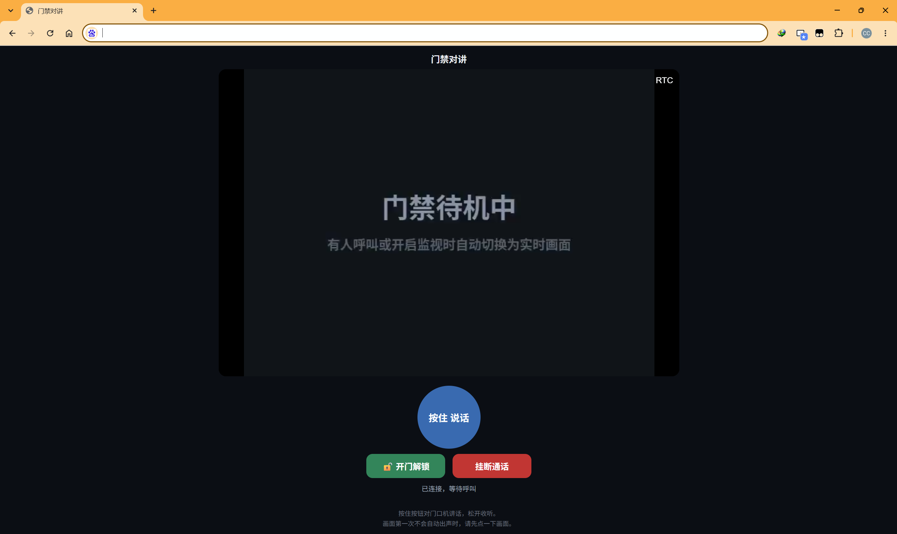
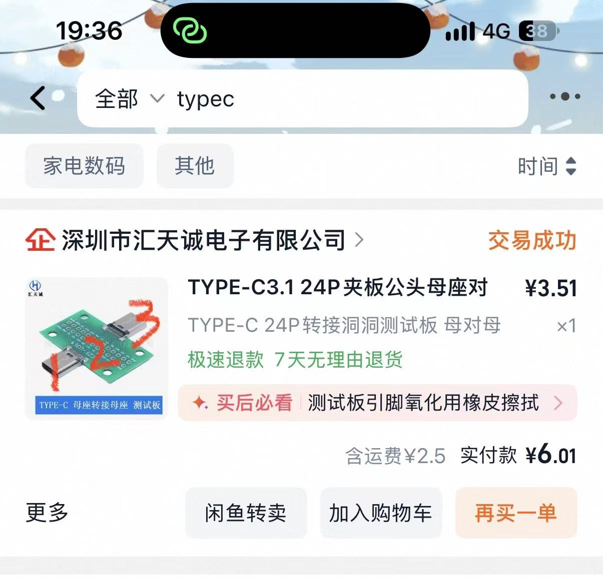

# 安居宝可视门禁 → Home Assistant 改造

把小区原有的**安居宝可视门禁**接入 Home Assistant：楼下按铃，平板自动跳转对讲画面；能看视频、能双向对讲、能远程开门。

改造思路是**冒充原室内主机**：ESP32 用双网卡，以太网口接门禁内网（静态 IP 与真实主机相同），WiFi 接家庭内网。真实主机断电保留，随时可以插回去。


---

## 效果预览

平板端实际效果（左：中控首页　右：门禁对讲面板）

| 中控首页 | 对讲面板 |
|---|---|
|  |  |

---

## 目录

- [系统架构](#系统架构)
- [部署教程（从零开始）](#部署教程从零开始)
- [端口与数据流](#端口与数据流)
- [关键设计（含踩坑记录）](#关键设计含踩坑记录)
- [常见问题排查](#常见问题排查)
- [更新日志](#更新日志)

---

## 系统架构

```
门口机 ×4 ──门禁内网 172.16.0.x── ESP32 双网卡 ──WiFi 192.168.1.x── fnOS 飞牛
                (UDP 6672/9880/6668)      (冒充 105.61)                      │
                                                                     ┌──────┴──────┐
                                                                 bridge      go2rtc
                                                                     │            │
                                                                     └──── RTSP ──┘
                                                                          │
                                                          ┌───────────────┼───────────────┐
                                                       HA 自动化       平板/手机
```

四个层次：

| 层 | 组件 | 职责 |
|---|---|---|
| ① 门禁内网 | 门口机 ×4、原室内主机（断电） | 呼叫、视频、语音 |
| ② 桥接层 | ESP32（WT32-ETH01） | 协议实现：应答寻人、接管呼叫、转发视频与语音 |
| ③ 服务层 | fnOS（飞牛 NAS） | 视频转 RTSP、WebRTC 网关、对讲面板 |
| ④ 终端层 | HA、小米平板、手机 | 自动化、看画面、对讲、开门 |

## 部署教程（从零开始）

这份教程假设你**完全没接触过 ESP32 和 Docker**，按顺序做完即可。

---

### 开始之前：先确认三件事

**① 硬件准备**

| 物品 | 型号 | 参考价 | 说明 | 购买截图 |
|---|---|---|---|---|
| 主控板 | **WT32-ETH01** | ¥19.56 | ESP32 + 有线网口，必须带 LAN8720 |  |
| 供电 | 非标 24V 转 5V POE 分离器 | ¥14.6 | 从门禁网线取电，给开发板和平板供电 |  |
| 转接 | Type-C 母版 | ¥6.01 | 焊在开发板上：一端接 POE 供电，一端接平板常亮 |  |
| 网线 | 普通网线 2 根 | — | 一根进门禁网、一根接门口机 | — |
| 服务端 | NAS / 软路由 / 小主机 | — | 要能 7×24 开机、能装 Docker | — |
| 平板 | 任意安卓平板 | — | 可选，用来看画面和开门 | — |

> 三张截图是实际下单记录，仅供参考，链接已失效，自行搜索型号即可。

**② 软件准备**

- 一台电脑（Windows / macOS 都行）
- 服务端能 SSH 登录（用户名 + 密码）
- 家庭 WiFi 的账号密码

**③ 必须满足的前提**

> ⚠️ **这一条不满足，整个方案做不了**：你必须能拔下家里**室内门禁机**的网线。
>
> 因为方案的核心是「用 ESP32 冒充室内机」。真实室内机断电保留，随时能插回去恢复原状。

---

### 第 0 步：搞清楚你家的门禁参数（最重要，别跳过）

后面所有配置都依赖这 4 个数字，先花 10 分钟把它们记下来。

**方法一：看室内机的设置界面（推荐）**

大部分安居宝室内机都藏了一个工程/信息界面，通常在「设置 → 系统信息 → 网络」里。你会看到类似这样的信息：

```
设备编码：XX楼XX单元12层03房      ← 房号 = 12 03
IP 地址：172.16.0.10           ← 室内机 IP
子网掩码：255.255.0.0
网关：172.16.0.1
```

把 **IP 地址**和**设备编码**记下来。

**方法二：没有设置界面时抓包**

1. 把笔记本接到门禁网线（用交换机分线或镜像口）
2. 用 Wireshark 抓包，过滤 `udp.port == 6672`
3. 门口机会定期广播寻人查询，包里能看到房号
4. 呼叫一次，看 TCP 18022 连接的源 IP 就是门口机 IP

**需要记录的 4 项**

| 参数 | 从哪来 | 例子 |
|---|---|---|
| 室内机 IP | 设置界面 | `172.16.0.10` |
| 房号（两字节） | 设备编码：12 层 03 房 → `0x0C,0x03` | `0x0C,0x03` |
| 门口机 IP | 抓包 / 逐个 ping | `172.16.0.11` |
| 子网掩码 | 设置界面 | `255.255.0.0` |

---

### 第 1 步：烧录 ESP32 固件

#### 1.1 安装 Python 和 ESPHome

**先装 Python**（电脑上还没有的话）：

1. 打开 https://www.python.org/downloads/ ，下载 3.10 以上版本
2. 安装时**务必勾选最下面的**「**Add Python to PATH**」
3. 装完关掉所有终端窗口重开

**验证 Python 装好了**，打开终端（Windows 按 `Win+R` 输 `powershell` 回车）：

```bash
python --version
# 应该输出 Python 3.10.x 或更高
```

**再装 ESPHome**：

```bash
pip install esphome==2026.8.2
```

> 版本必须锁 2026.8.2。2026.9.x 及以上版本编这个固件会报错。

**验证安装成功**：

```bash
esphome version
# 应该输出 2026.8.2
```

> 如果提示 `pip 不是内部或外部命令`，说明 Python 没加到 PATH，重装 Python 并勾选那个选项。
>
> 如果 `pip install` 很慢或超时，换国内源：
> `pip install esphome==2026.8.2 -i https://pypi.tuna.tsinghua.edu.cn/simple`

#### 1.2 下载本项目

```bash
git clone https://github.com/xiaolifashi/anjubao-home-assistant.git
cd anjubao-home-assistant/firmware
```

#### 1.3 新建 `secrets.yaml`

在 `firmware/` 目录下新建一个文件 `secrets.yaml`（**不要提交到 GitHub**）：

```yaml
wifi_ssid: "你家WiFi的名字"
wifi_password: "你家WiFi的密码"
api_key: "随便生成32位字符，比如 abcdef1234567890abcdef1234567890"
ota_password: "随便设一个，比如 12345678"
```

#### 1.4 修改 `doorbell.h` 的配置

用记事本或 VS Code 打开 `firmware/doorbell.h`，找到开头的「用户配置」区域，改这几项：

```c
// ① 改成第 0 步记下的室内机 IP
#define DB_ETH_IP        "172.16.0.10"

// ② 改成第 0 步记下的子网掩码
#define DB_ETH_MASK      "255.255.0.0"

// ③ 改成第 0 步算出的房号（12 层 03 房 = 0x0C,0x03）
#define DB_ROOM_HI       0x0C
#define DB_ROOM_LO       0x03

// ④ 改成你的门口机 IP（有几个写几个，不确定的先写单元门口那台）
static const DbGate DB_GATES[] = {
  {"172.16.0.11", "单元一楼"},
  {"172.16.0.13", "单元负一楼"},
};
```

还要改一处 —— **视频桥所在机器的 IP**：

```c
#define DB_VIDEO_FWD_IP  "192.168.1.10"   // 你的 NAS / 小主机内网 IP
```

#### 1.5 首次烧录（USB 线）

1. 用 Type-C 线把 WT32-ETH01 插到电脑
2. 打开「设备管理器」确认出现串口（Windows 是 COM3 之类）
3. 执行：

```bash
esphome run doorbell-bridge.yaml
```

4. 提示选择设备时，选那个 USB 串口
5. 等待编译 + 上传（第一次约 5~10 分钟）

看到 `SUCCESS` 就成功了。

#### 1.6 验证固件是否正常

```bash
esphome logs doorbell-bridge.yaml
```

正常应该看到：

```
[I][app:151]: ESPHome version 2026.8.2
[C][ethernet]: Ethernet: IP Address: 172.16.0.10   ← 你的室内机 IP
[I][doorbell]: 6672 应答任务已启动
```

**如果看不到以太网 IP**，说明网线没接好或 IP 冲突，检查：

- 网线是否插在 WT32 的网口上（不是 Type-C）
- 真实室内机是否已断电（IP 冲突会导致都上不了线）

#### 1.7 后续升级用 OTA（不用再插线）

```bash
esphome run doorbell-bridge.yaml --device 192.168.1.48
```

---

### 第 2 步：部署服务端（NAS / 小主机）

#### 2.1 确认装了 Docker

SSH 登录你的 NAS，执行：

```bash
docker --version
docker compose version
```

两个都有输出就行。没有的话先装 Docker（群晖 / 威联通 / 飞牛都有套件）。

#### 2.2 上传项目文件

把仓库的 `bridge/` 目录整个传到 NAS 上，比如放到 `/vol1/1000/docker/doorbell/`：

```bash
# 在你自己的电脑上执行（把 user 和 IP 换成你的）
scp -r bridge/ user@192.168.1.10:/vol1/1000/docker/doorbell/
```

#### 2.3 生成 HTTPS 证书

对讲面板必须走 HTTPS（浏览器要求麦克风权限必须在安全上下文里）：

```bash
cd /vol1/1000/docker/doorbell
chmod +x gen_certs.sh
./gen_certs.sh
```

会生成 `certs/server.crt` 和 `certs/server.key`。

#### 2.4 修改 `docker-compose.yaml`

打开文件，改这几个值：

```yaml
environment:
  ALLOWED_SRC: "192.168.1.48"            # 改成 ESP32 的 WiFi IP
  ESP32_IP: "192.168.1.48"                # 同上
  HA_BASE: "http://192.168.1.11:8123"     # 你的 HA 地址
  HA_WEBHOOK_UNLOCK: "你的解锁webhook"       # 见第 3 步
  HA_WEBHOOK_HANGUP: "你的挂断webhook"
```

#### 2.5 启动

```bash
docker compose up -d
docker compose logs -f
```

看到 `listening 9880` 和 `panel https 8443` 就好了。

#### 2.6 验证服务是否正常

浏览器打开：

- `http://你的NAS_IP:1984/` —— go2rtc 管理界面，应该能看到 `menjin` 流
- `https://你的NAS_IP:8443/` —— 对讲面板（会提示证书不安全，点「继续访问」）

**此时面板应该有画面**（门禁待机画面）。如果黑屏，看第 2.5 步的日志有没有 `Broken pipe`。

---

### 第 3 步：接入 Home Assistant

这一步全部在 HA 的**网页界面**里操作，不需要改文件（除了 3.2 要粘贴一段配置）。

---

#### 3.1 添加 ESP32 设备

**操作路径**：左侧菜单「设置」→「设备与服务」→ 右下角「**+ 添加集成**」

1. 在搜索框输入 `ESPHome`，点它
2. 弹出对话框，填两项：
   - **主机**：填 ESP32 的 **WiFi IP**（`192.168.1.48` 之类，**不是**门禁网的 IP）
   - **端口**：保持 `6053`
3. 点「提交」
4. 如果提示要 **加密密钥**，粘贴 `secrets.yaml` 里 `api_key` 那一串字符
5. 再点「提交」

**成功的标志**：出现一个叫「门禁桥接器」的设备卡片，下面挂着一堆实体。

点进去能看到这些实体（名字可能略有不同）：

| 实体 | 类型 | 含义 |
|---|---|---|
| 门禁状态 Status | 文本 | 空闲 / 呼叫中 / 监视中 |
| 门口机呼叫中 Ringing | 二进制 | `on` = 正在呼叫 |
| 被呼叫总次数 CallCount | 数字 | 累计呼叫次数 |
| 解锁 / 挂断 / 监视 | 按钮 | 点一下执行对应动作 |

> ❗ 如果添加失败，先在电脑上执行 `ping 192.168.1.48` 确认能通，再执行 `esphome logs` 确认设备在线。

---

#### 3.2 准备 rest_command（让 HA 能控制平板）

这一步要给 HA 加 4 个「远程指令」，用来唤醒平板、让它响铃、跳转页面。

**第一步：装一个能编辑文件的工具**

HA 默认没有文件编辑器，需要装加载项：

1. 「设置」→「加载项」→ 右下角「**加载项商店**」
2. 搜索 `File Editor`，点「**安装**」
3. 装完点「**启动**」，再打开「**显示在侧边栏**」开关
4. 左侧菜单会多出一个「File Editor」图标

**第二步：编辑 `configuration.yaml`**

1. 点左侧「File Editor」
2. 在文件列表里找到 `configuration.yaml`，点开
3. 拉到**最下面**，另起一行，粘贴下面这段：

```yaml
rest_command:
  fully_panel:
    url: "http://192.168.1.49:2323/?password=你的Fully密码&cmd=loadURL&url=https%3A%2F%2F192.168.1.10%3A8443%2F"
    method: get
  fully_home:
    url: "http://192.168.1.49:2323/?password=你的Fully密码&cmd=loadURL&url=http%3A%2F%2F192.168.1.11%3A8123"
    method: get
  fully_ring:
    url: "http://192.168.1.49:2323/?password=你的Fully密码&cmd=playSound&url=http%3A%2F%2F192.168.1.11%3A8123%2Flocal%2Fring.wav"
    method: get
  fully_wake:
    url: "http://192.168.1.49:2323/?password=你的Fully密码&cmd=screenOn"
    method: get
```

**要改的 3 个地方**：

| 占位符 | 改成什么 |
|---|---|
| `192.168.1.49` | 你平板的 IP（Fully Kiosk 里能看到） |
| `你的Fully密码` | Fully Kiosk 的远程管理密码 |
| `192.168.1.10` / `.11` | 你的 NAS IP / HA IP |

4. 点右上角「**保存**」（磁盘图标）

**第三步：把提示音放到 HA 里**

1. 在 File Editor 里进入 `www` 文件夹（没有就新建一个）
2. 把仓库的 `assets/ring.wav` 上传进去
3. 这样 `http://你的HA:8123/local/ring.wav` 就能访问了

**第四步：重启 HA**

「设置」→「系统」→ 右上角「**重启**」→ 点「重启 Home Assistant」。

> 必须重启，`rest_command` 不支持热加载。

**验证**：重启后去「开发者工具」→「服务」，搜索 `fully`，能看到 `rest_command.fully_panel` 等 4 个服务就对了。

---

#### 3.3 建自动化一：有人按铃 → 平板跳到面板

**先理解要做什么**：楼下按铃时，平板要依次做三件事——点亮屏幕 → 响铃 → 打开对讲页面。

**操作路径**：左侧「设置」→「自动化与场景」→ 右下角「**+ 创建自动化**」

会弹出一个向导，点「**创建新的自动化**」，进入编辑器界面。界面上有三块：**触发器**、**条件**、**动作**。我们只用「触发器」和「动作」。

**① 加触发器（什么时候触发）**

1. 点「**+ 添加触发器**」
2. 在弹出列表里选「**状态**」
3. 出现三个输入框，这样填：
   - **实体**：点输入框，在列表里找 `门口机呼叫中 Ringing`（或搜索 `ringing`）
   - **从**：留空
   - **到**：填 `on`
   - **持续时长**：留空
4. 点「保存」

> 意思是：这个实体的状态变成 `on` 时，就触发。

**② 加动作（触发后做什么）**

点「**+ 添加动作**」，依次加 4 个：

**动作 1 —— 点亮屏幕**

1. 选「**调用服务**」
2. **服务**：搜 `fully_wake`，选 `REST 命令: fully_wake`
3. 其他留空，点「保存」

**动作 2 —— 等 1 秒**（等屏幕亮起来）

1. 点「+ 添加动作」→ 选「**延迟**」
2. 填 `1` 秒
3. 点「保存」

**动作 3 —— 平板响铃**

1. 点「+ 添加动作」→ 选「**调用服务**」
2. **服务**：搜 `fully_ring`，选 `REST 命令: fully_ring`
3. 点「保存」

**动作 4 —— 跳转到对讲面板**

1. 点「+ 添加动作」→ 选「**调用服务**」
2. **服务**：搜 `fully_panel`，选 `REST 命令: fully_panel`
3. 点「保存」

**③ 保存自动化**

1. 右上角「**保存**」
2. 弹出对话框填名字：`门禁-振铃跳转面板`
3. 点「保存」

**验证**：去楼下按一次铃，平板应该 1 秒内亮屏、响铃、跳到对讲画面。

> 如果动作里搜不到 `fully_xxx`，说明 3.2 的 rest_command 没配好，或者 HA 没重启。

**用 YAML 更省事？** 点编辑器右上角「⋮」→「**编辑为 YAML**」，直接粘贴：

```yaml
alias: 门禁-振铃跳转面板
trigger:
  - platform: state
    entity_id: binary_sensor.你的门禁_ringing
    to: "on"
action:
  - service: rest_command.fully_wake
  - delay: "00:00:01"
  - service: rest_command.fully_ring
  - service: rest_command.fully_panel
mode: single
```

粘贴后记得把 `entity_id` 改成你实际的实体名（在「开发者工具 → 状态」里搜 `ringing` 能查到）。

---

#### 3.4 建自动化二：挂断 2 分钟后 → 回首页

不然平板会一直停在对讲页面。

**操作路径**：同样「设置」→「自动化与场景」→「+ 创建自动化」→「创建新的自动化」

**① 加触发器**

1. 点「+ 添加触发器」→ 选「**状态**」
2. **实体**：选 `门口机呼叫中 Ringing`
3. **到**：填 `off`
4. **持续时长**：填 `00:02:00`（2 分钟）
5. 点「保存」

> 「持续时长」的意思是：状态变成 `off` 并**保持** 2 分钟才触发。这样通话中途短暂断开不会误跳。

**② 加动作**

1. 点「+ 添加动作」→ 选「**调用服务**」
2. **服务**：搜 `fully_home`，选 `REST 命令: fully_home`
3. 点「保存」

**③ 保存**

起名 `门禁-挂断回首页`，保存。

YAML 版：

```yaml
alias: 门禁-挂断回首页
trigger:
  - platform: state
    entity_id: binary_sensor.你的门禁_ringing
    to: "off"
    for: "00:02:00"
action:
  - service: rest_command.fully_home
mode: single
```

---

#### 3.5 建 webhook：让面板上的「解锁 / 挂断」按钮能用

面板页上的按钮点了没反应？因为面板不知道要找谁开门。需要给 HA 建两个「暗号地址」（webhook），面板点按钮时就去敲这个地址。

**① 建解锁 webhook**

1. 「设置」→「自动化与场景」→「+ 创建自动化」→「创建新的自动化」
2. 点「+ 添加触发器」→ 往下滚，选「**Webhook**」
3. 会出现一个「Webhook ID」输入框，**随便填一串英文字符**，比如 `doorbell-unlock-2026`
   > 这串字符就是暗号，记下来，等下要用
4. 点「保存」
5. 点「+ 添加动作」→ 选「**调用服务**」
6. **服务**：搜 `button.press`（服务名就叫 `按钮: 按下`）
7. **目标**：点「选择实体」，搜 `解锁`，选门禁的那个解锁按钮实体
8. 点「保存」
9. 右上角保存，起名 `门禁-面板解锁`

**② 建挂断 webhook**

重复上面步骤，但：

- Webhook ID 填另一个，比如 `doorbell-hangup-2026`
- 动作里的实体选 `挂断` 那个按钮
- 起名 `门禁-面板挂断`

**③ 把 webhook ID 填回服务端**

1. SSH 登录 NAS
2. 编辑 `docker-compose.yaml`：

```yaml
HA_WEBHOOK_UNLOCK: "doorbell-unlock-2026"
HA_WEBHOOK_HANGUP: "doorbell-hangup-2026"
```

3. 重启容器：

```bash
docker compose restart
```

**验证**：浏览器打开面板 `https://NAS:8443/`，点「解锁」按钮，应该能听到楼下开门的声音（或者看 HA 里按钮实体被触发）。

---

### 第 4 步：平板设置（可选）

平板负责「显示画面 + 响铃 + 对讲 + 开门」，建议买一台便宜的安卓平板壁挂。

#### 4.1 安装 Fully Kiosk

1. 平板打开应用商店，搜 `Fully Kiosk Browser`，安装（免费版够用）
2. 打开 App，首次会问要不要设为桌面，选「**稍后**」
3. 进入设置（右上角齿轮）

#### 4.2 设置起始页面

1. 设置 → **Web Content Settings** → **Start URL**
2. 填你的 HA 地址，比如 `http://192.168.1.11:8123`
3. 返回，点「Load Start URL」测试能不能打开 HA

#### 4.3 打开自动播放音频（最关键的一步）

1. 设置 → **Web Content Settings**
2. 往下找到「**Autoplay Audio**」
3. 把开关**打开**

> ⚠️ 这一项不开，对讲面板**永远不会有声音**——哪怕代码、服务器、网络全都正常。这是 Android WebView 的限制，不是 bug。

#### 4.4 设置远程管理密码（HA 要用）

1. 设置 → **Remote Administration**
2. 打开「**Enable Remote Administration**」
3. 设置一个**密码**（记下来，3.2 的 rest_command 要用）
4. 页面上会显示平板的访问地址，类似 `http://192.168.1.49:2323`

#### 4.5 开启 Kiosk 模式（全屏锁定）

1. 设置 → **Kiosk Mode**
2. 打开「**Enable Kiosk Mode**」
3. 建议同时打开：
   - **Keep Screen On**（屏幕常亮）
   - **Prevent Sleep**（禁止休眠）

#### 4.6 验证

在电脑浏览器打开 `http://平板IP:2323`，输入密码，能看到 Fully 的管理界面就说明配置成功，HA 就能远程控制它了。

---

### 第 5 步：验收清单

按顺序验证，哪步不过就查对应章节：

- [ ] ESP32 能上网（`esphome logs` 看到以太网 IP）
- [ ] go2rtc 里 `menjin` 流是 `online`（`http://NAS:1984/`）
- [ ] 面板 `https://NAS:8443/` 有画面（待机画面）
- [ ] HA 里能看到门禁实体，状态是「空闲」
- [ ] 去楼下按铃 → HA 里「呼叫中」变成 `on`
- [ ] 平板自动跳到面板，有画面、有声音
- [ ] 点「解锁」能开门
- [ ] 点「挂断」能结束
- [ ] 对着门口机说话，面板能听到（**如果听不到，查「关键设计 3」的半双工问题**）

---

## 端口与数据流

### 门禁内网侧（ESP32 以太网）

| 端口 | 协议 | 方向 | 用途 |
|---|---|---|---|
| 6672 | UDP | 双向 | 寻人查询 / 应答（只应答本户） |
| 18022 | TCP | 门口机 → ESP32 | 呼叫连接，回 705 应答 |
| 18022 | TCP | ESP32 → 门口机 | 发 710 接听、518 解锁、708 挂断 |
| 9880 | UDP | 门口机 → ESP32 | 视频 RTP（12 字节头 + H.264 切片） |
| 6668 | UDP | 双向 | **语音**：门口机发访客声，主机发住户声 |
| 6671 | UDP | 双向 | RTCP |

### 家庭内网侧（ESP32 WiFi）

| 端口 | 协议 | 用途 |
|---|---|---|
| 9880 | UDP | 视频转发给视频桥 |
| 9990 | UDP | 下行音频（访客语音）转发给视频桥 |
| 6670 | UDP | 上行音频（住户语音）入口 |
| 6053 | TCP | ESPHome 原生 API（HA 接入） |

### 服务层

| 端口 | 服务 | 用途 |
|---|---|---|
| 8554 | go2rtc | RTSP 入口（视频桥推 `menjin` 到这里） |
| 1984 | go2rtc | 管理/API |
| 8555 | go2rtc | WebRTC |
| 8443 | 视频桥 | 对讲面板 HTTPS |
| 9991 | 视频桥 | 内部：音频喂给 ffmpeg |

## 关键设计（含踩坑记录）

### 1. 视频：剥 RTP 头，而不是重新封装

门口机的视频是「12 字节 RTP 头 + 裸 H.264 切片」，没有 FU-A 分片。视频桥按序拼接后直接管道喂给 ffmpeg，`-c copy` 不转码，CPU 占用极低。

### 2. 待机画面：空闲时注入预生成帧

门口机只在呼叫/监视时推视频。空闲时流会消失，导致 go2rtc 里没有这个流、HA 报「不可用」。视频桥在空闲 3 秒后注入预生成的「门禁待机中」画面（H.264 IDR，参数与门口机一致），实时视频一到立即无缝切换。

### 3. 语音：门口机是**半双工**的（最容易踩的坑）

**通话期间绝对不要向门口机持续发送音频**——哪怕全是数字静音（0xD5）。门口机会把"持续有音频输入"判定为**住户正在说话**，于是**一直静音自己的麦克风**，表现就是：平板完全听不到楼下说话，但楼下能听到平板。

代码里对应：

```c
#define DB_SEND_KEEPALIVE 0   // 通话期间是否发送预录静音保活
```

**不要"优化"回 1**。实测数据：开启保活时门口机回传的音频电平是 `-72 dB`（纯静音），关闭后同一台门口机立刻变成 `-46 dB / 峰值 -15 dB`（真实语音）。

上行语音走独立通道（桥 → UDP 6670 → 门口机），只在面板按住说话时发送，正好符合半双工语义。

### 4. ffmpeg 必须加 `-max_interleave_delta 0`

ffmpeg 双输入（视频 pipe + 音频 UDP）时，任一路没有数据就会阻塞整个读取循环。监视场景只有视频没有音频，音频饿死会让复用器等不到数据，最终把 RTSP 连接拖断（Broken pipe），表现为面板画面卡死。

见 `bridge/run.sh`。

### 5. 浏览器不能直接播 RTSP

必须在中间放 go2rtc 转 WebRTC。go2rtc 的流必须**预声明**（`menjin: []`），否则新版 go2rtc 不允许匿名推流，ffmpeg 一推就被静默断开。

### 6. 平板播放的两个坑（Android WebView / Fully Kiosk）

- **Fully Kiosk 的 `Autoplay Audio` 必须开启**，否则 Android WebView 直接拒绝页面出声，代码怎么写都没用
- **不要用 Web Audio 接管视频音频**（`createMediaElementSource`）：在 Android WebView 上即使 `AudioContext` 是 running、也报告连接成功，实际仍然不出声。保持播放器直出即可

### 7. 录像：分片 MP4 + 按流设置标签

- 用 **fMP4**（`+frag_keyframe+empty_moov`）而不是普通 MP4：普通 MP4 写入中没有 moov 索引、播放器打不开，崩溃还会留下坏文件
- **H.264 流不能加 `-tag:v hvc1`**（那是 HEVC 的），否则报 `Tag hvc1 incompatible with output codec id 27` 并写出 0 字节文件
- 不要用 segment 复用器 + `-reset_timestamps 1` + fMP4：音频 DTS 重置会触发 `non monotonically increasing dts` 并让 ffmpeg 直接退出。改用「循环 + `-t 600`」每段独立文件

### 8. ESPHome 改 .h 后必须强制重编

ESPHome **不追踪** `includes:` 引入的头文件变化。改完 `doorbell.h` 后，必须让 YAML 配置哈希变化（改实际配置项，改注释无效）或清理构建目录，否则会静默复用旧产物。确认方法：对比 `.bin` 文件大小或 `config_hash`。

## 常见问题排查

### 面板画面卡在 loading

1. 看桥日志有没有 `Broken pipe` → 检查 ffmpeg 的 `-max_interleave_delta 0`
2. 看 go2rtc 里 `menjin` 有没有 producer → 检查视频桥是否在推流
3. `curl http://<飞牛IP>:1984/api/streams` 看流状态

### 能听到楼下，但楼下听不到

**检查是否还在发保活静音**（见「关键设计 3」）。这是最常见的原因。

### 平板完全没声音，但手机/电脑有

Fully Kiosk → Web Content Settings → **Autoplay Audio** 开启；同时确认没有用 Web Audio 接管。

### ESPHome 日志连不上（EOF received / errno=128）

API 连接槽被反复尝试的日志连接占满了。**重启设备**即可。不用降级加载器。

### 门口机录像 0 字节

H.264 流误用了 `-tag:v hvc1`。见「关键设计 7」。

## 更新日志

### 2026-10-31

- **修复：下行语音完全无声** —— 根因是持续发送保活静音触发门口机半双工静音。关闭保活后一楼门口机双向对讲恢复正常
- **修复：上行语音断续** —— 同上，一并解决
- **修复：门禁视频断流** —— ffmpeg 加 `-max_interleave_delta 0`
- **修复：门口机录像 0 字节** —— H.264 误用 HEVC 标签
- **修复：平板无法出声** —— Fully Autoplay Audio + 关闭 Web Audio 接管
- **新增**：门口机振铃自动录像（带声音）
- **新增**：固件诊断传感器（音频收包计数 / 空闲内存 / 主循环耗时）

### 2026-10-04

- 首个可用版本：视频接入、双向对讲、远程解锁、振铃跳转

## 已知问题

- 门禁内网用的是 `192.168.0.0/16` 大网段，与家庭内网 `192.168.1.0/24` 重叠，ESP32 必须靠双网卡 + 绑定网卡发出来隔离。

## 许可

个人自用改造项目，仅供参考。涉及门禁设备请遵守当地法规与物业管理规定。
